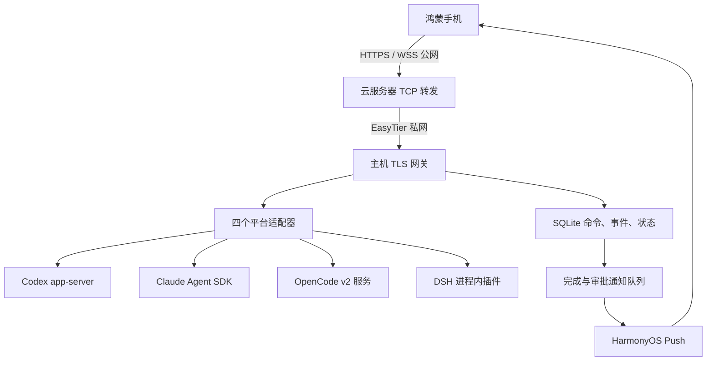
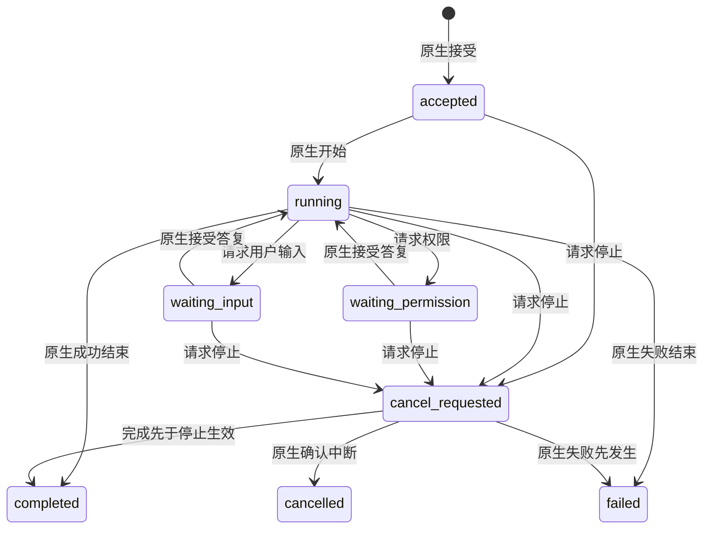
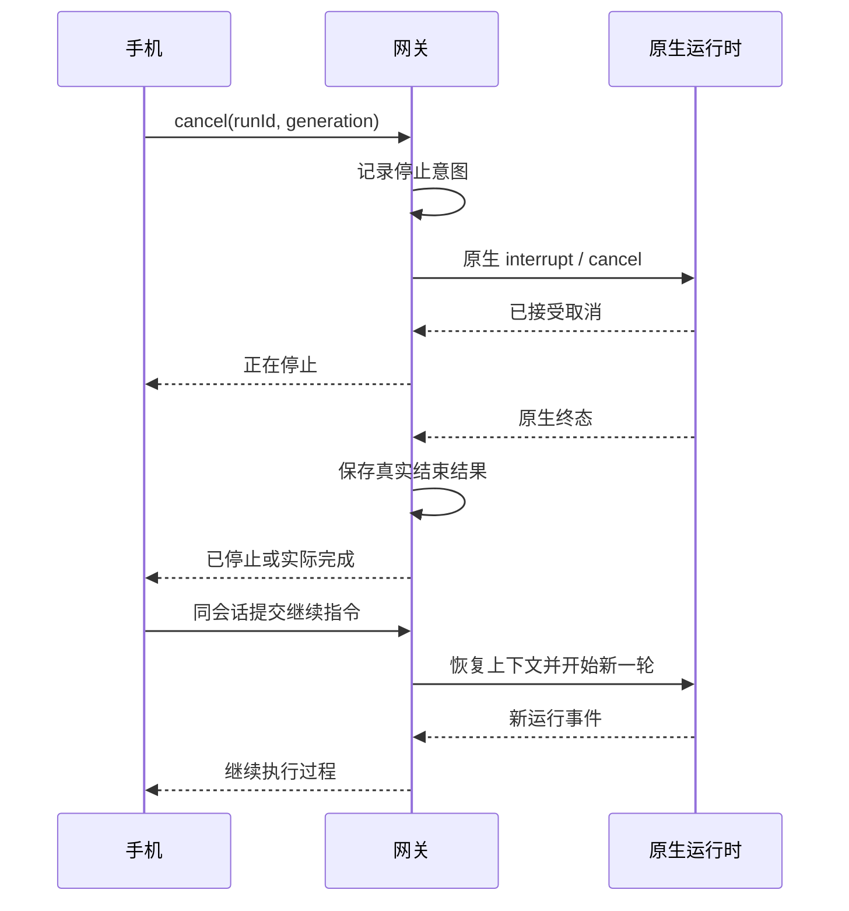

# AI Maid Café 四平台手机控制台开发计划书

**交付形式：离线开发版 · 正文与接口资料合并 · 2026-11-16**  
**目标项目：`zonda-xu/AI-Maid-Caf-`**  
**对标项目：`ChenJun25/dsh-console-hm`**  
**目标引擎：Codex、Claude Code、OpenCode、DeepSeek Harness**

> 本文给不能访问互联网的开发 agent 使用。外部资料中与本次实现有关的接口、字段、事件、语义、示例及限制已提取到附录。开发不以打开外部链接为前置条件。文中出现的网络地址用于实际运行或说明接口地址，不是要求开发者访问的参考链接。
>
> 本文是基于代码与协议资料核查形成的开发方案，没有声称四个平台已经完成真机联调。代码开发、协议回放和模拟服务测试可以离线完成；真实模型运行、手机公网连接及系统推送验收需要相应运行环境、账号、网络与设备。

## 1. 目标与交付定义

在现有鸿蒙手机应用中完成同一条控制闭环：

1. 手机选择主机、工作目录及引擎，创建会话并发起任务。
2. 主机上的真实 AI 程序执行任务，手机持续显示文本、工具执行和状态。
3. 原生程序请求权限或提出问题时，手机显示待处理卡片，答复回到原生等待点。
4. 手机停止当前运行，原生程序确认结束后显示“已停止”。
5. 手机在同一原生会话中继续，保留已有上下文与工作目录。
6. 任务结束后，手机能看到明确的成功、失败或停止结果；后台通知点击后进入对应会话。

第五项“继续”定义为：**在原会话历史和当前文件状态上开始下一轮执行**。它不承诺恢复已终止命令的 CPU 指令位置，也不自动撤销此前文件修改。任务中的后台服务或用户自行脱离执行器启动的进程，不因停止一轮 AI 执行就必然退出；界面必须按实际执行器确认的范围描述停止结果。

本次围绕上述五项核心能力及其必要消息通路开发。保持现有女仆主题界面、信任与配对体系、三主机配置及 EasyTier 网络结构。远程桌面、插件市场、定时任务、跨主机调度、文件管理器不列入本次实现。

### 1.1 最重要的接管边界

完整控制需要连接**拥有该会话执行权的同一个运行时**。知道会话 ID、读到历史文件或发现一个进程，并不等于拥有审批和停止能力。

| 引擎 | 本计划的完整控制范围 | 已在主机打开的会话如何纳入 |
| --- | --- | --- |
| Codex | 已登记、可连接的同一个 app-server 中的线程 | 网关和桌面 CLI 连接同一个 app-server；不能把另开 app-server 后读取同一份历史当作接管原进程 |
| Claude Code | 由主机适配器通过官方 Agent SDK 持有的会话 | 已结束且可恢复的会话可用 `resume` 继续；任意独立终端正在执行的 Claude 会话，尚无本文已验证的通用热接管接口 |
| OpenCode | 已登记的同一个 OpenCode v2 后台服务拥有的会话 | 桌面端和网关连接同一后台服务，使用其 session、event、permission、form 接口 |
| DeepSeek Harness | 加载本项目控制插件的 DSH 宿主拥有的会话 | 插件在原宿主内获得 `sessionController` 和审批事件，可以控制该宿主中的既有会话 |

**交付不能把只读历史展示、另一进程中的同 ID 会话、官方其他手机应用的远程控制，计为本项目手机端的完整控制。** 如果要求完全不改变任意现有 Claude 终端的启动方式且直接接管其当前运行，这一附加要求目前不能由已核实接口证明可交付，必须单独记录为未满足，不能用 Channels 或终端字符识别替代后宣称完成。

### 1.2 相对对标实现的具体增量

对标仓库证明了 DSH 插件内可以取得会话控制器、跟踪执行并处理手机审批。该仓库公开部分主要是主机插件，不能据此声称已经审查其全部手机端源码。

本项目的交付增量是：**把这条 DSH 单引擎控制链扩展到四种原生执行协议，在现有公网与 EasyTier 通路上，为手机提供一致的任务、审批和停止语义。** 核心工作在运行时所有权、原生事件映射与断线后的状态核对，不在增加一组相似按钮。

## 2. 核查基线与版本固定

以下是本计划采用的资料快照。提交标识用于追溯，开发 agent 不需要联网获取它们才能理解本计划。

| 对象 | 基线/目标 | 用途 |
| --- | --- | --- |
| AI-Maid-Caf- | v0.3.0；`6cb57bf5e17ae7d78928040c5608b498230f6aeb` | 当前代码审查基线 |
| dsh-console-hm | v0.5.86；`26d98dc2ed3cb7bede7f9471d2ed7fa5d8f7e68a` | DSH 手机控制实现参照 |
| Codex | 发布标签 `rust-v0.169.0`；`d32063f96c2dff1dc96af839b3952abb6acfeda4` | 原生协议目标；附录 A 以该发布版生成类型为准 |
| Claude Agent SDK | `@anthropic-ai/claude-agent-sdk@0.3.325` | 官方 TypeScript SDK 接口快照 |
| Claude Code | SDK manifest 对应 `2.1.325`；`a360e7297ecfcddeae9ec99fb3c93153ed86aca4` | 拟联调 CLI 版本，不等于已完成该组合的实机测试 |
| OpenCode | `@opencode/client@2.3.0`、`@opencode/cli@2.3.0`；源码 `d5ea1ee6761eaba9787b09211b23d6d76288aded` | 固定 v2 服务接口；包版本已核实存在 |
| DeepSeek Harness | `b830ec950faba0a46dda564be3e2d854afed94f1`；session-controller `0.2.1-rc.5` | 附录 D 的 controller 与交互契约 |
| 项目工具链 | Node `>=24.13 <25`；TypeScript `5.9.3` | 延续当前仓库工具链 |

Codex WebSocket app-server 仍具有实验性质。OpenCode v2 的 OpenAPI 元信息 `0.0.1` 是接口文档版本，不是 CLI 安装版本。以上版本必须写入锁文件和测试报告；不得一边采用本附录字段，一边运行另一个未经验证的版本。

采用一次协调升级：网关、桌面管理端、适配器与手机协议统一升级。保留用户已有证书、配对、主机身份、工作区及历史数据；不同时维护两套控制协议，不增加旧 ACP 与新 HTTP 控制的双轨实现。

## 3. 当前项目具备什么，还缺什么

### 3.1 代码级差距

| 区域 | 当前代码事实 | 为本次目标必须完成的改动 |
| --- | --- | --- |
| 网络 | 已有公网入口、EasyTier、主机 TLS 网关与配对 | 保持拓扑，完成真实公网双向链路验收 |
| 网关 | 已有命令回执、SQLite 事件与投影、会话路由 | 增加真实运行时绑定、恢复核对、精确结束语义 |
| 外部会话 | Codex、DSH 主要通过只读历史导入；`externalSource` 被统一禁止写操作 | 将历史来源与控制绑定分离；只有实际绑定同一原生运行时后开放控制 |
| 能力上报 | 通用适配器预设完整能力；探测主要检查版本 | 根据已连接运行时和协议验证结果上报，不用 `--version` 成功代替可运行、已登录或可审批 |
| Codex | 已有私有 stdio app-server 和部分会话、执行、审批映射 | 连接受管理的共享 app-server；补齐权限请求、活动状态、重连与原生请求关联 |
| Claude | 自建 stream-json 子进程和 permission MCP 桥 | 用官方 SDK 的持久输入流、回调与 interrupt 接口替换该控制路径 |
| OpenCode | 当前使用独立 `opencode acp` | 用同一 v2 后台服务替换 ACP 控制路径，接入 HTTP、SSE、权限与表单 |
| DSH | 适配器与桥主要允许 probe、外部列表、历史、观察；手机硬编码只读 | 插件实现 create、prompt、cancel、审批、提问和完整事件流，再开放能力 |
| 手机 | 已有会话、消息、交互卡片及网络服务 | 按服务端能力与状态显示按钮，补足任务创建、停止确认与继续流程 |
| 系统推送 | 已有设备绑定和持久队列；生产发送 transport 未接通 | 接入附录 E 的官方发送契约；改为当前运行的结束/交互事件驱动 |

### 3.2 DSH 为什么现在禁用“新建并执行”

这是**当前项目的控制链尚未完成**造成的限制，不能推导为 DSH 原生不支持。

当前 DSH 桥没有形成可验证的原生控制与审批闭环，手机又有固定的只读判断。直接删除禁用按钮会产生“手机显示已提交，主机没有真实执行”“收到审批却无处答复”等问题。

正确顺序是：插件取得原生 controller → 创建与执行 → 过程事件 → 审批答复 → 取消与结束确认 → 同会话继续 → 端到端测试 → 能力上报 → 手机开放入口。`0.2.1-rc.5` 是要适配的具体契约，不应成为永久禁用整个引擎的判断条件。

## 4. 运行架构与网络



### 4.1 沿用现有端口，不借用其他项目网络

| 用途 | 配置 |
| --- | --- |
| 独立 EasyTier 网络 | `agent-console-mesh`，`10.89.90.0/24` |
| EasyTier peer 端口 | `12080`，具体传输沿用部署配置 |
| 主机网关 | `8899`，只在已授权接口上监听 |
| macOS 公网入口 | `18541` → `10.89.90.3:8899` |
| Linux 公网入口 | `18542` → `10.89.90.4:8899` |
| Windows 公网入口 | `18543` → `10.89.90.2:8899` |
| DSH 本地桥 | `127.0.0.1:8898` |
| Codex 本地共享 app-server | 本计划分配 `127.0.0.1:8897`；启动时检查占用并明确报错 |
| OpenCode 本地服务 | 使用其服务登记信息，不在手机或 VPS 固定暴露原生端口 |

端口表以项目当前部署为基线；本地地址、证书和实际主机名由部署配置提供。云服务器只转发字节，TLS 在主机终止。手机保留已有主机身份校验、配对令牌与信任方式。原生模型凭据、SDK 控制器、DSH 插件接口不转交公网。

手机发起的任意创建、运行、审批及停止请求，必须同时验证配对身份、目标 `hostId`、工作区授权和会话绑定。工作目录由主机登记的 `workspaceId` 解析，手机不能通过任意 `cwd` 越过授权目录。

### 4.2 生命周期

原生运行时由主机管理服务持有，不由手机 WebSocket 连接持有。手机切后台、断网或重连不关闭原生执行进程。

Codex 与 OpenCode 的服务重启属于主机生命周期操作，不得在某个请求超时后自动换一个新进程接着写。Claude 的 SDK Query 由适配器长期持有；若承载它的主机进程退出，需核实原生会话状态后恢复，不能假设其内存回调仍存在。DSH 桥重连到同一个仍运行的插件时，可以重新查询插件持有的待处理请求；DSH 宿主重启则是另一种情况。

## 5. 统一控制契约

本节是**拟议的本项目协议**，不是任何原生 AI 工具现成的 API。具体原生调用必须使用附录 A—D。

### 5.1 四层身份

| 对象 | 必须保存的信息 | 目的 |
| --- | --- | --- |
| 主机 | `hostId` | 避免公网入口或手机切主机后串发命令 |
| 运行时 | `runtimeInstanceId`、引擎、原生端点身份、连接代次 `generation` | 避免把重启前审批答复发给新进程 |
| 会话 | 项目 `sessionId`、原生 `nativeSessionId`、`workspaceId` | 同一上下文继续与目录归属 |
| 一轮执行 | `runId`、可用时的原生 turn/message ID、触发命令 ID | 关联过程、结果和取消目标 |

沿用 `SessionRef` 的主结构。新增 `binding` 表示实际控制连接，不用历史导入来源推断控制权限：

```ts
type RuntimeBinding = {
  runtimeInstanceId: string;
  generation: number;
  nativeSessionId: string;
  state: 'attached' | 'disconnected' | 'unbound';
  capabilities: {
    create: boolean;
    submit: boolean;
    observe: boolean;
    approve: boolean;
    answer: boolean;
    cancel: boolean;
    resume: boolean;
  };
};
```

能力是运行时事实。缺少认证、原生接口握手失败或原生审批回调未接通，必须给出具体不可用原因；不能默认全开，也不能把 DSH 引擎整体写死为只读。

`generation` 只在原生运行时身份或实际控制句柄重建时递增；手机重连、同一插件的桥重连不自行升代。否则仍有效的原生审批会被错误作废。

### 5.2 手机 HTTP 接口

将现有协议整体提升为版本 2，统一使用 `/v2` 路由；应用间一次协调升级。以下是最小接口面，不额外建设任务平台。

| 操作 | 方法与路径 | 关键行为 |
| --- | --- | --- |
| 运行时与工作区 | `GET /v2/bootstrap` | 返回授权工作区、能力、连接状态及手机所需投影 |
| 创建会话 | `POST /v2/sessions` | 原生创建成功后持久化绑定；不假造本地空会话即成功 |
| 当前状态 | `GET /v2/sessions/{sessionId}` | 返回会话、运行、待审批/问题及 watermark |
| 历史事件 | `GET /v2/sessions/{sessionId}/events?afterSeq=...` | 返回网关已持久化的事件；不是透传原生无回放流 |
| 执行/停止/答复 | `POST /v2/commands` | 同一入口承载 `submit`、`cancel`、`decide`，延续已有设计 |
| 回执查询 | `GET /v2/commands/{clientRequestId}` | 同一配对设备查询自己发送的命令 |
| 实时订阅 | `WSS /v2/events` | 订阅指定会话，带本地 `afterSeq`，先补齐再接实时 |
| 推送绑定 | `GET/PUT/DELETE /v2/devices/self/push` | 沿用已有语义，版本统一 |

创建会话请求例：

```json
{
  "protocolVersion": 2,
  "hostId": "host-linux",
  "clientRequestId": "req-create-001",
  "workspaceId": "ws-project-a",
  "runtimeInstanceId": "runtime-dsh-main",
  "engineId": "deepseek-harness"
}
```

创建会话与首次提交分两步持久化。手机的“新建并执行”可以连贯调用这两步，第二步失败时显示已创建的会话及真实提交状态，不能重试整个流程导致重复创建并运行。

提交请求例：

```json
{
  "protocolVersion": 2,
  "hostId": "host-linux",
  "clientRequestId": "req-submit-001",
  "sessionId": "session-project-a",
  "ref": {
    "hostId": "host-linux",
    "workspaceId": "ws-project-a",
    "runtimeInstanceId": "runtime-dsh-main",
    "engineId": "deepseek-harness",
    "nativeSessionId": "native-session-example"
  },
  "action": "submit",
  "payload": {
    "text": "运行项目测试，修复失败项，最后说明修改和测试结果。",
    "expectedGeneration": 3
  }
}
```

停止 `payload` 使用 `{ "runId": "run-001", "expectedGeneration": 3 }`；答复使用 `{ "interactionId": "interaction-001", "expectedGeneration": 3, "answer": ... }`。`answer` 按权限与问题的类型区分，不能把字符串 `yes` 当通用原生授权。

“继续”复用 `submit`：同一会话，新的 `clientRequestId` 与 `runId`，必要时适配器先恢复原生会话。无需再发明一个不同上下文的“继续任务”接口。

### 5.3 回执和任务结束分离

沿用并明确现有回执层次：

| 回执 | 含义 | 手机文字 |
| --- | --- | --- |
| `received` | 网关已持久记录，尚未取得原生确认 | 已接收，等待主机确认 |
| `native_accepted` | 原生协议确认接受本次操作 | 已提交；停止请求则显示正在停止 |
| `rejected` | 明确未被接受，附错误原因 | 提交失败/无法答复 |
| `uncertain` | 写入原生通道后丢失确认，暂不能判断是否执行 | 正在核对执行状态 |

`native_accepted` 不等于任务成功。原生 `cancel` 返回成功也不等于工具已经终止。任务终态只由有依据的原生事件或恢复核对产生。

### 5.4 幂等与并发

1. 所有变更请求以 `(pairedDeviceId, clientRequestId)` 建唯一键；同键不同正文拒绝。
2. 手机点击重发只重用原键；网关返回已有回执，不重新调用原生执行。
3. 在数据库中记录发送意图，再调用原生接口，再写回确认；同时保存原生关联 ID。
4. 进程恰好在原生接受后、保存确认前崩溃时，可能产生不确定窗口。恢复先查询原生记录，不自动再次执行。仅有 JSON-RPC 请求 ID 不能提供跨进程“恰好一次”。
5. 每个会话的控制命令顺序处理；本次手机普通任务只在无活动运行、且前一轮停止请求没有仍在途或待核对的情况下提交，不新增任务队列界面。自然完成先到也不能让一个尚未确定送达结果的旧停止请求与下一轮交错。
6. 保留同目录冲突控制，但要区分“连接既有运行”和“新开第二个写入者”。网关无法保证阻止用户在任意外部终端手动写同一目录，不能对这种范围作互斥保证。
7. 停止严格关联目标 `runId` 和代次。上一轮晚到的停止请求不得中断下一轮。

### 5.5 事件与状态机

继续使用项目已有事件类别：`message.delta`、`message.completed`、`tool.updated`、`agent.updated`、`run.updated`、`interaction.created`、`interaction.closed`、`model.confirmed`、`error`。增加可靠关联字段，不扩建独立消息总线。

```ts
type ConsoleEvent = {
  protocolVersion: 2;
  eventId: string;
  hostId: string;
  sessionId: string;
  runtimeInstanceId: string;
  generation: number;
  runId?: string;
  seq: number;                 // 网关会话内持久递增序号
  time: string;
  type: string;
  nativeEventId?: string;      // 原生有稳定 ID 才填写
  payload: unknown;            // 各事件使用独立 schema 校验
};
```



图中省略了 accepted/等待态直接失败的边，以及无效答复后的自环；实现必须接受真实原生终态从任一非终态到达。连接状态另存，不因 WSS 断开把运行变为失败。现有 `uncertain` 表示“运行事实待核对”，不是可继续写入的空闲状态。

结束状态遵守以下规则：

- 最后一条 assistant 文本只能证明输出了文本，不能证明整轮结束。
- 一轮拒绝审批后仍可能继续解释或尝试另一种做法，不能立即标成整轮失败。
- 多个并行工具或子任务的单独完成不能结束主运行。
- 原生完成与停止竞态时保存真实结束原因；已成功结束的任务不被后到的取消回执改成取消。
- 完成结果保留最终文本、工具结果/错误、可获得的文件变更信息及结束原因；没有最终文本的失败也要显示可定位错误。

## 6. 四个平台的实现任务

### 6.1 DeepSeek Harness：先完成对标闭环

**控制入口：同一 DSH 宿主内的 `ctx.get('sessionController')`，加交互事件处理器。**

1. 重写 `plugins/dsh-bridge/index.mjs` 的控制接口：沿用已有 loopback WebSocket RPC，提供受本机鉴权保护的 create、prompt、cancel、snapshot、subscribe、decide。
2. 桥的消息名称是本项目接口，内部调用附录 D 的真实 controller；禁止凭名称猜 `ctl.respond()`、`ctl.events()`。
3. 插件持有待审批/提问 Promise 的 resolver；手机答复调用这个 resolver，让原生执行继续。
4. 用 `follow()` 同时取得打开时快照、持久事件和 assistant-stream；按 `seq` 与流的 attempt/revision/index 去重。
5. `cancel()` 仅停止当前原生 turn。等待 `turn/end` 等原生证据，并重新核对运行状态。
6. DSH 原生已有待执行 inbox 时，取消当前 turn 不清空 inbox。手机明确表示“当前轮已停止”；下一轮若被宿主启动，要显示新的运行，不能把整个会话画成停止不动。
7. 执行与取消闭环通过后，删除手机和适配器的引擎级只读硬编码，改为能力驱动。

同一张审批卡可以在电脑或手机先答复；只能结算一次。另一个设备收到 `interaction.closed` 后撤下卡片，晚到答复返回“已处理”，不能再次授权。

### 6.2 Codex：连接同一个 app-server

**控制入口：受管理的本机 app-server，JSON-RPC。**

1. 将当前每次独立启动 stdio 实例的主路径，改为主机服务管理并登记一个共享 app-server；网关连接其本机端点。
2. 本机桌面 CLI 若参与同一会话，通过相同 app-server 连接。仅从 Codex 桌面应用的历史文件导入，不能证明其活动任务可接管。
3. 按附录 A 完成 initialize、initialized、thread/start、thread/resume、turn/start、turn/interrupt。
4. 订阅消息增量、工具开始/完成、turn 开始/结束以及线程活动状态。
5. 审批响应保留**原生 JSON-RPC request ID 的原始类型和值**。不得用 item ID、turn ID 或本项目 interaction ID 替代。
6. 分别处理命令执行、文件变更、附加权限和用户问题，不将它们压成同一个布尔值。
7. 断连后向同一服务恢复线程订阅并读取状态/历史。未证明原运行已结束前，不另起进程继续写同一目录。

WebSocket 通路和桌面 CLI 共享行为必须做一次真实版本契约验证。若本地目标安装的命令行参数与附录不符，记为版本不匹配阻塞，不能静默改成历史文件控制。

### 6.3 OpenCode：改用 v2 后台服务

**控制入口：同一 OpenCode v2 服务的本机 HTTP API 与 SSE。**

1. 移除当前 ACP 控制主路径，固定本文的 v2 版本。
2. 使用 `Service.discover()` 发现已存在服务，取得端点与认证头；不要对正常服务无条件执行 `ensure()`。
3. 仅在明确没有现有服务、主机管理端正在启动已配置运行时时调用 `ensure()`。discover 返回 undefined 也可能是版本不匹配，需核对服务登记信息和 PID，不能直接当“没有进程”。ensure 具有替换不匹配/无响应服务的行为，不能被普通手机读请求或短暂探测失败触发。
4. `/api/session` 创建；`/prompt` 接受用户输入；`/api/event` 接收原生事件；permission/form 接口回复交互。
5. 用 `/interrupt?resume=false` 停止当前运行；根据执行终态事件与会话状态确认。返回 `interrupted:false` 只说明该进程当前没有可中断执行，需核对是否已结束或绑定错服务。
6. `GET /api/event` 为实时 SSE，不承诺补发断线期间事件。重连必须重新读取会话、消息和待处理交互，不能依赖不存在的原生 replay cursor。

本文使用 v2 的 `/api/...` 路由；不要混入旧 SDK 的 `/session/{id}/message` 等 v1 写法。

### 6.4 Claude Code：持久 SDK Query

**控制入口：官方 `@anthropic-ai/claude-agent-sdk`，持续存在的 `Query` 对象。**

1. 替换手写 stream-json 控制帧和 permission MCP 桥，删除完成替换后的旧控制实现。
2. 为每个受管理会话持有 AsyncIterable 用户输入队列和 `query()` 返回的 Query；每次手机断开不得结束输入迭代器。
3. `includePartialMessages: true` 获取文本/工具参数流；最终 `assistant`、`user` 工具结果及 `result` 构成持久输出。
4. `canUseTool` 等待手机答复，返回规范的 `allow` 或 `deny`；原生 AbortSignal 关闭失效卡片。
5. `AskUserQuestion` 将手机答案写入 `updatedInput.answers`，保持原问题文本作为映射键。
6. `Query.interrupt()` 发起取消；检查 receipt 中待运行输入，并等待对应轮次的 `result`、停止原因及原生控制证据。不得仅因方法 Promise resolve 就宣告所有工具已退出。
7. 已存在 Query 的下一轮继续向其输入队列写入；Query 已结束时以 `options.resume` 恢复同一会话 ID。
8. 启动时指定本地 `pathToClaudeCodeExecutable`，避免离线环境触发自动下载。认证复用该运行账户已有的合法配置，手机不持有账号凭据。

Channels、Claude 官方 Remote Control 与 SDK 的官方云会话桥不作为本项目的替代控制通路；它们不自动提供本项目所需的完整自托管控制协议。

## 7. 全链路行为与恢复规则

### 7.1 手机发起任务

手机选择授权工作区 → 网关验证身份、能力、目录与运行状态 → 原生创建/恢复 → 命令落库 → 原生接受 → 原生开始 → 事件落库 → WSS 送达手机。

验收证据必须包含主机上真实创建或修改的测试文件、原生会话 ID、网关 run ID 和手机输出。只验证 HTTP 200 或模拟进度动画不算通过。

### 7.2 过程和完成结果

增量事件按原生消息/工具 ID 归并。完整消息到达时，用其权威文本替换对应增量构建结果，不再追加一次。工具 stdout/stderr 与最终 assistant 文本分开；只展示原生实际提供的推理摘要或可见内容，不伪造内部思考。

同一数据库事务提交事件、投影和需要发送的通知意图，再向在线手机广播。手机处理 `seq`：重复跳过；有缺口先补齐；不能只比较本地时钟。

### 7.3 审批

原生挂起点 → 适配器登记真实回调/请求 → `interaction.created` → 手机答复 → 网关校验会话、运行代次、待处理状态 → 原生接受 → `interaction.closed`。

答复并发通过单次结算实现。原生进程或运行代次变化后，旧审批不能复活。手机断线不代表拒绝审批；原生撤回或停止才关闭相应等待。

每次授权只覆盖卡片显示的范围。原生支持“本次允许”“会话允许”时分别表示；原生不支持某档权限时不显示该按钮。权限请求中的命令、路径和来源应完整展示，不能仅以“是否继续”替代。

### 7.4 停止与继续



停止超时显示“尚未确认停止”，保留查询和实际状态，不自动释放可能仍在执行的工作区锁。强杀整个应用不作为正常停止路径。继续前先核对没有上一轮活动执行，随后创建新的 run ID。

### 7.5 断线/重启恢复

| 场景 | 处理 |
| --- | --- |
| 手机断网或被系统挂起 | 主机继续执行；回前台拉取 snapshot 与缺失网关事件，再恢复 WSS |
| 网关仍在线、手机 WSS 中断 | 使用网关持久 `seq` 补发，不要求原生支持历史事件重播 |
| 网关与原生服务的事件流中断 | 保留原生运行；重连后以原生状态、消息与待交互重建投影 |
| OpenCode SSE 断线 | 建立新订阅并缓冲事件，同时读取快照；合并后再次核对状态，解决读取过程中的竞态 |
| DSH follow 断线 | 重新打开取得新 snapshot；`page(throughSeq)` 补历史；按 seq 去重，不传不存在的 afterSeq 参数 |
| 主机网关重启、原生服务仍活着 | 重新连接同一服务，核对活动运行与交互，禁止重复提交先前不确定命令 |
| SDK/原生宿主退出 | 持久历史可恢复不等于活动执行可恢复；先判断旧执行是否消失，关闭失效交互，之后才能继续 |
| 手机离线时审批已经被电脑处理 | snapshot 不再包含该待处理卡；历史保留已处理事实；手机旧答复不得再次生效 |

原生断线期间的瞬时 token 增量可能无法重建；完整消息、工具结果及最终状态必须恢复。不能声称还原了原生根本没有持久化的每个流片段。

## 8. 手机交互与系统通知

### 8.1 手机需要的最小界面行为

| 位置 | 行为 |
| --- | --- |
| 主机/引擎选择 | 展示连接状态和真实能力，不能单靠在线灯判断可运行 |
| 新建任务 | 选择授权目录与引擎，输入文本，连贯完成创建和提交 |
| 会话详情 | 文本、工具卡、运行状态、结果统一显示；原生消息 ID 归并增量 |
| 审批/问题 | 展示实际请求范围和原生可用选项；等待服务端确认后关闭 |
| 停止 | 针对当前 run；点击后为“正在停止”，确认后更新真实终态 |
| 继续 | 原会话无活动运行后可用；可输入补充要求；提交产生新运行 |
| 断线 | 显示连接状态与最后同步位置，不能把运行进度清零或显示已结束 |
| 通知点击 | 依据 host/session/interaction 定位，重新校验当前状态，不直接执行批准 |

无需重做视觉主题。重点修改现有 `ConsoleController`、`Projection`、`Protocol` 和 `InteractionCard`。

### 8.2 系统通知

完成、失败、停止以及需要用户处理的交互可产生通知；不为每个 token 发推送。对同一运行终态或同一交互使用稳定去重键。

修改当前只接受外部只读 assistant 消息的推送门槛，改为已授权本地主机运行的明确事件：

- `run.updated` 首次进入 `completed/failed/cancelled`。
- `interaction.created` 且确实需要用户处理。
- 历史导入和首次快照不制造“刚完成”通知。

通知只包含定位信息和必要摘要，不携带模型密钥、配对令牌或审批执行令牌。使用附录 E 的 HarmonyOS 官方协议；发送接口成功、设备收到、系统展示是不同阶段。核心验收须检查真机展示和点击恢复，不只检查推送服务返回值。

## 9. 按现有目录划分修改任务

| 文件/目录 | 具体工作 |
| --- | --- |
| `packages/protocol/src/types.ts` | 协议 2、绑定/代次、回执语义、事件关联、交互类型 |
| `packages/adapters/common/base.ts` | 移除预设全能力；握手与实际能力报告；统一状态归并工具 |
| `packages/adapters/codex/` | 共享 app-server 连接、协议映射、审批、恢复 |
| `packages/adapters/claude-code/` | 官方 SDK Query 管理；移除已替代的 permission MCP 控制 |
| `packages/adapters/opencode/` | v2 服务发现、HTTP、SSE、permissions、forms；替换 ACP |
| `packages/adapters/deepseek-harness/` | 完整桥客户端、follow 事件映射、控制能力 |
| `plugins/dsh-bridge/index.mjs` | controller 调用、事件流、待交互 registry、单次结算 |
| `apps/gateway/src/core.ts` | 按真实绑定授权控制，运行级命令串行、目录锁、终态归并 |
| `apps/gateway/src/server.ts` | `/v2` 请求校验、回执查询、订阅恢复 |
| `apps/gateway/src/store.ts` | 身份/运行映射、原子事件与通知、幂等和恢复字段 |
| `apps/gateway/src/external.ts` | 历史来源与真实控制绑定分离，避免初始 idle 误报 |
| `apps/gateway/src/push.ts`、`main.ts` | 终态/交互通知、官方 transport、统一生命周期装配 |
| `apps/desktop/src/host.ts`、`service.ts`、`main.ts` | 本地运行时登记、启动、版本检查和状态显示 |
| `apps/harmony/entry/src/main/ets/model/Protocol.ets` | 手机协议同步更新 |
| `apps/harmony/entry/src/main/ets/services/` | 修改 ConsoleController、GatewayApi、Projection、PushService；保留 Vault/Trust 的身份保障 |
| `apps/harmony/entry/src/main/ets/pages/Index.ets` | 去除 DSH 固定只读判断，接入创建/停止/继续 |
| `apps/harmony/entry/src/main/ets/components/` | InteractionCard、MessageCard 的原生交互与消息归并 |
| `tests/` 与协议 fixtures | 四平台录制/合成协议回放、恢复竞态、真机测试记录模板 |

上述个别文件路径应以本地基线目录为准；若 checkout 不同，先做路径与提交差异确认，不能直接套用到未知分支。审查已确认的行为与拟新增行为应在提交描述中分开。

## 10. 实施顺序与工作量

估算以熟悉 TypeScript/ArkTS 的开发者为基准，单位为有效开发与验证小时，不包含等待账号开通或设备到位。按依赖推进，无需同时展开多个 agent。

| 阶段 | 内容 | 小时 | 完成门槛 |
| --- | --- | --- | --- |
| M0 | 固定基线与离线环境，核对四个平台本机契约 | 8–12 | 依赖就绪、协议样例可读可解析、版本记录完整 |
| M1 | 协议 2、绑定、命令回执与状态核心 | 16–24 | 模拟原生服务下五项完整流程成立，重复命令不重跑 |
| M2 | DSH 插件及适配器 | 16–24 | 同宿主创建、实时查看、审批、停止、继续全部通过 |
| M3 | Codex 共享 app-server | 16–24 | 同运行时控制、审批 ID、结束与恢复测试通过 |
| M4 | OpenCode v2 服务 | 16–24 | SSE、消息重建、permission/form、interrupt 全部通过 |
| M5 | Claude SDK | 24–40 | 持久 Query、权限/问题回调、中断和 resume 全部通过 |
| M6 | 手机流程与投影 | 16–24 | 四引擎使用同一套交互，状态/卡片不靠引擎硬编码 |
| M7 | 公网恢复、推送、真实端到端与竞态 | 24–40 | 第 11 节矩阵通过，保存证据与失败定位 |
| M8 | 打包、部署文档、迁移与交付整理 | 8–12 | 一套可部署版本，离线文档和测试报告一致 |
| 合计 | 完整范围 | **144–224** | 约 24–38 个有效 6 小时工作日 |

时间最大的不确定项是原生会话恢复、桌面与手机审批竞态、Claude 进程生命周期、HarmonyOS 真机推送。应在 M2—M5 各自验证真实接口，不能直到 M7 才第一次运行原生程序。

每个阶段都交付代码、对应原生/模拟测试记录和未通过项。中间版本可以提交仓库供审查，但不能把“只有模拟器通过”写成正式功能已完成。

## 11. 验收矩阵

表中“四平台”表示每个引擎分别执行。测试结果在开发后填写；本计划不预填通过。

| ID | 范围 | 操作 | 必须观察到的证据 |
| --- | --- | --- | --- |
| T01 | 四平台 | 手机新建，要求在授权目录创建唯一测试文件 | 原生会话、命令和 run 关联正确；主机文件真实存在 |
| T02 | 四平台 | 运行多步任务，包含可观察的工具调用 | 手机执行中出现文本和工具进度，最终消息无双份 |
| T03 | 四平台 | 正常完成；另做一次明确失败任务 | 终态来自原生结束证据，成功/失败区分正确 |
| T04 | 四平台 | 触发真实权限请求，在手机单次允许 | 原生等待、手机卡片、允许后实际执行三者一致 |
| T05 | 四平台 | 拒绝同类请求 | 被拒绝操作未执行；之后原生解释不被误判为新成功 |
| T06 | 四平台 | 触发原生提问并在手机答复 | 原生收到正确结构的答案，继续执行可验证 |
| T07 | 四平台 | 在受控的长工具执行中停止 | 先显示正在停止，确认后显示已停止；受控工具不再写测试心跳文件 |
| T08 | 四平台 | 停止后在同一会话继续 | nativeSessionId 不变；新 runId；能引用此前上下文和文件状态 |
| T09 | 四平台 | 手机提交后立即断网，再恢复 | 主机只执行一次，结果补齐，运行状态不因手机离线丢失 |
| T10 | 四平台 | 重复点击/重传相同 clientRequestId | 原生只产生一个对应任务，回执一致 |
| T11 | 四平台 | 在原生接受后切断回执通路 | 显示待核对；恢复根据原生记录判断，不自动再提交 |
| T12 | 四平台 | 两个已配对客户端竞争答复；有原生桌面审批路径时再测手机与桌面竞争 | 仅一个原生决定生效；旧卡片关闭；晚到答复无作用；不为此虚构 Claude 独立终端接管 |
| T13 | 四平台 | 等待审批时停止，再发送旧审批答案 | 被停止运行不能由旧答案复活 |
| T14 | 四平台 | 接近完成瞬间发送停止 | 保存真实结果，已完成不被改为已取消 |
| T15 | 四平台 | 网关重启，原生服务保留 | 重新识别活动会话，不重复执行、不伪造审批回调 |
| T16 | 四平台 | 原生运行时异常退出 | 状态与错误真实；不能凭历史文本标成功；恢复前核对旧运行 |
| T17 | 四平台 | 手机切换主机后发送旧页面命令 | host/ref/generation 校验阻止错发 |
| T18 | 四平台 | 关闭应用/锁屏时完成或请求审批 | 真机系统通知出现；点击后定位并查询当前状态 |
| T19 | DSH | 宿主另有 pending inbox 时取消当前 turn | 当前 turn 停止，后续原生启动如实显示；没有“取消即清队列”假象 |
| T20 | OpenCode | 中断 SSE，期间任务结束，再重连 | 通过消息/会话/交互重建最终状态，不依赖 SSE 回放 |
| T21 | Codex | 桌面 CLI 与手机连接同一 app-server 的线程 | 双端观察同一原生 turn，审批与停止可作用于同一执行 |
| T22 | Claude | 手机连续两轮输入，然后 SDK 结束后 resume | Query 存续时复用；重建后同 session；旧回调不被重用 |
| T23 | 公网 | 手机关闭 Wi-Fi，只走移动网络访问 VPS | 四平台指令与事件均穿过公网和 EasyTier，未借助手机私网直连 |
| T24 | 推送 | 重复事件、token 轮换、已处理审批后点击通知 | 不重复发同一终态；旧绑定不能删除新绑定；旧通知不能授权 |

T07 使用明确由原生执行器管理的测试子进程，例如每秒写入一个计数且不自行 daemonize。不同平台对后台任务的控制范围必须单独记录，不能用最简单的文本生成取消测试代替长工具取消。

至少在当前已有的 macOS、Linux、Windows 主机配置上验证网关与路径、进程、编码行为；引擎原生不支持某一环境时按其实际支持矩阵记录，不虚构 4×3 全部运行通过。

性能目标作为项目验收指标而非上游承诺：正常网络下手机收到增量相对网关入库的 P95 延迟不超过 2 秒；普通命令网关持久回执 P95 不超过 1 秒；100 次重传不产生重复执行。原生模型计算时间和工具自身耗时单独记录。

## 12. 离线开发和交付要求

### 12.1 必须提前放入开发环境的材料

- 本项目基线 checkout、Node 24 工具链、已有依赖缓存与锁文件。
- Codex 0.169.0 本机可执行文件及其可用登录环境。
- Claude Agent SDK 0.3.325 包、其 peer dependencies、Claude Code 2.1.325 本机可执行文件。
- OpenCode client/CLI 2.3.0 包及其本机依赖；用于协议核对的同版本服务。
- DSH 对应宿主和插件开发依赖；本计划附录中的 controller 与交互类型。
- 已安装的 HarmonyOS SDK、构建工具与调试签名；真机推送需要项目配置、服务账号和设备。

Markdown 能包含编码资料，不能代替上述二进制、依赖缓存、真实账号与证书。缺少某个安装包时应记录“本地依赖未提供”，不能把联网安装命令当作离线开发步骤，也不能假称已做原生验收。

Claude SDK 包完整性：

```text
@anthropic-ai/claude-agent-sdk@0.3.325
sha512-MhSm2Fhk3DA/hhjdCKXDZWlnykpPWJjX42SogllAHMplY9ZKT+Ltb8QPtQxpe225Imfs4A8IKaNE4biivA+fHg==

@opencode/client@2.3.0
sha512-xu74XGiYIqLZ2FzIrtjaR5UNWWXY3fRln0WLgZoQTR/wWMgG+T9XGQQGCl8ry8jnCFsJVokiHemBqft9oMzC1A==

@opencode/cli@2.3.0
sha512-Q5RV8jLJ4O8bY2O8X2hkBOkgPf6+nDB9MEkz/Q/Cc4Ojd2SwUFFzEd1LzgNGKiXiS7g/9+/X4eqhrxY60fLMOQ==
```

SDK 对应 peer dependencies：`@anthropic-ai/sdk >=0.93.0`、`@modelcontextprotocol/sdk ^1.29.0`、`zod ^4.0.0`。实际离线构建时把解析后的具体版本固定在锁文件，不能只靠版本范围保证可复现。

### 12.2 本地执行顺序

1. 比较本地提交与第 2 节基线，记录实际差异。
2. 验证本地 CLI 版本和本文接口，不进行运行中实例的自动替换。
3. 用本文 JSON/类型样例建立 fixtures，先测适配器与网关映射。
4. 执行仓库已有 `npm run typecheck`、`npm test`、`npm run check:source`、`npm run check:assets`；只运行实际存在的脚本。
5. 运行每个平台的本地契约测试，再做受控原生任务。
6. 用本地已安装的鸿蒙构建工具编译和运行手机；记录 SDK 版本、构建命令及签名环境。
7. 执行第 11 节公网与真机矩阵，保存实际日志。

所有自编协议示例都要由 JSON/schema 校验器读取，不把文档中的占位 ID 当成可跨会话使用的真实 ID。任何 `TODO: 查官方文档` 都不能作为本次核心路径的交付状态；版本实测不符应留下具体报文和字段差异，回报阻塞。

### 12.3 最终交付清单

- [ ] 四个平台分别通过五项核心能力；结果能对应原生执行。
- [ ] 手机后台完成/审批通知与点击定位通过真机测试。
- [ ] 旧历史、证书、配对和工作区数据被正确保留。
- [ ] DSH 固定只读禁用已由真实能力判断替换。
- [ ] Claude 不再依赖自建 permission MCP 控制桥；OpenCode 不再双轨保留 ACP 控制。
- [ ] 能力、回执、状态、审批、停止与恢复逻辑都有对应验证证据。
- [ ] 离线接口说明、版本锁定和本地 fixtures 随代码交付。
- [ ] 报告明确哪些是真实原生/真机通过，哪些仅是模拟测试；未通过项不计完成。

---

## 附录 A：Codex 原生接口离线摘录

### A.1 传输与初始化

本项目使用 JSON-RPC 消息形态：请求包含 `id/method/params`，响应包含同一个 `id` 和 `result` 或 `error`，通知不带 `id`。不要强制要求每帧包含 `jsonrpc: "2.0"` 字段；以 Codex app-server 实际线协议为准。stdio 为每行一个 JSON；本机 WebSocket 使用 JSON 消息帧。

共享运行方式：

```sh
codex app-server --listen ws://127.0.0.1:8897
```

桌面 CLI 连接同一运行时的命令形式：

```sh
codex --remote ws://127.0.0.1:8897
```

以上来自 app-server 使用资料，属于实验接口。部署前直接用目标二进制的 `codex app-server --help`、`codex --help` 核对参数并做本机连接测试；无需互联网。仅监听 loopback，不把这个端口暴露到 VPS。

初始化请求：

```json
{
  "id": 1,
  "method": "initialize",
  "params": {
    "clientInfo": {
      "name": "ai-maid-cafe",
      "title": "AI Maid Café Gateway",
      "version": "0.4.0-dev"
    },
    "capabilities": {
      "experimentalApi": true,
      "requestAttestation": false
    }
  }
}
```

收到初始化响应后发送：

```json
{ "method": "initialized" }
```

示例版本号是拟开发应用标识，不代表已经发布。JSON-RPC 传输层必须支持客户端请求与服务端请求同时在途，不能把服务端审批误读成普通通知。

### A.2 会话与执行

创建线程，示例以 Linux 已授权目录为例：

```json
{
  "id": 2,
  "method": "thread/start",
  "params": {
    "cwd": "/srv/work/project-a",
    "approvalPolicy": "on-request",
    "sandbox": "workspace-write"
  }
}
```

从响应 `result.thread.id` 保存原生线程 ID。恢复/加入同一服务中的线程：

```json
{ "id": 3, "method": "thread/resume", "params": { "threadId": "thread-example" } }
```

`thread/resume` 的发布版类型明确允许重新加入该 app-server 中已加载线程；恢复历史不应随意更改 cwd、模型或权限配置。

开始下一轮：

```json
{
  "id": 4,
  "method": "turn/start",
  "params": {
    "threadId": "thread-example",
    "input": [
      { "type": "text", "text": "运行测试并报告结果。", "text_elements": [] }
    ]
  }
}
```

从 `result.turn.id` 保存 turn ID。`turn/start` 参数还可接受 `clientUserMessageId`；使用前按本地类型确定其值域并验证消息关联，不能把此字段存在视为原生自动去重保证。

停止该轮：

```json
{
  "id": 5,
  "method": "turn/interrupt",
  "params": { "threadId": "thread-example", "turnId": "turn-example" }
}
```

响应到达后等待 `turn/completed`。`TurnStatus` 的取值为：`inProgress`、`completed`、`interrupted`、`failed`。

本次手机不新增运行中插队交互；如内部需要识别原生 steering，真实方法为 `turn/steer`，参数至少包含 `threadId`、`input`、`expectedTurnId`。不得把普通提交自动变成插队输入。

### A.3 事件映射

| 原生 method | 读取重点 | 本项目输出 |
| --- | --- | --- |
| `thread/status/changed` | `threadId`、线程状态 | 绑定与活动状态核对 |
| `turn/started` | thread、turn | `run.updated: running` |
| `item/started` | item ID、类型 | 文本或工具卡开始 |
| `item/agentMessage/delta` | item ID、`delta` | `message.delta` |
| `item/commandExecution/outputDelta` | item ID、`delta` | 命令输出增量 |
| `item/completed` | 完整 item | 权威文本或工具结果替换增量 |
| `turn/completed` | turn ID、status、error | 成功/取消/失败终态 |

线程状态的发布版结构：

```ts
type ThreadStatus =
  | { type: 'notLoaded' }
  | { type: 'idle' }
  | { type: 'systemError' }
  | { type: 'active'; activeFlags: string[] };
```

`activeFlags` 此处用字符串数组概括以便阅读，正式代码使用目标版本生成类型。未知原生 item 类型保留类型标识及原始数据供审查，不猜测为完成事件。

### A.4 三类权限与用户问题

**命令执行请求：**`item/commandExecution/requestApproval`。请求包含 threadId、turnId、itemId，以及可用时的命令、cwd、原因和其他授权信息。保存整个 params 以供准确展示与协议校验。

**文件变更请求：**`item/fileChange/requestApproval`。

这两类的基础响应为：

```json
{ "id": 101, "result": { "decision": "accept" } }
```

这里 `101` 必须是**收到的服务端请求 ID**。若收到的是字符串，则响应也使用同一个字符串。可用基础值为 `accept`、`acceptForSession`、`decline`、`cancel`。命令执行还定义带策略修改的对象分支；本次不增加策略编辑器，但不能把这些对象错误转换成布尔值。

**附加权限请求：**`item/permissions/requestApproval`。

```ts
type AdditionalNetworkPermissions = { enabled: boolean | null };
type AdditionalFileSystemPermissions = {
  read: string[] | null;
  write: string[] | null;
  globScanMaxDepth?: number;
  entries?: unknown[]; // 详细规则保持原生对象，本次不提供规则编辑器
};
type PermissionRequest = {
  threadId: string;
  turnId: string;
  itemId: string;
  environmentId: string | null;
  startedAtMs: number;
  cwd: string;
  reason: string | null;
  permissions: {
    network: AdditionalNetworkPermissions | null;
    fileSystem: AdditionalFileSystemPermissions | null;
  };
};
type PermissionResponse = {
  permissions: {
    network?: AdditionalNetworkPermissions;
    fileSystem?: AdditionalFileSystemPermissions;
  };
  scope: 'turn' | 'session';
  strictAutoReview?: boolean;
};
```

允许时返回已展示、被用户明确选中的原生请求范围，不自行扩大。拒绝新增权限可返回空 `permissions` 并明确 scope；不能把这一类也回复 `{decision:"accept"}`。

**用户问题：**`item/tool/requestUserInput`。

```ts
type UserQuestion = {
  id: string;
  header: string;
  question: string;
  isOther: boolean;
  isSecret: boolean;
  options: { label: string; description: string }[] | null;
};
type UserQuestionRequest = {
  threadId: string;
  turnId: string;
  itemId: string;
  questions: UserQuestion[];
  isBlocking: boolean;
  autoResolutionMs: number | null;
};
type UserQuestionResponse = {
  answers: Record<string, { answers: string[] }>;
};
```

答复例：

```json
{
  "id": "native-question-request-1",
  "result": {
    "answers": {
      "test_scope": { "answers": ["运行全部测试"] }
    }
  }
}
```

`isBlocking` 决定是否进入等待状态；`autoResolutionMs` 已被标为弃用，不能用它猜测阻塞。`isSecret` 问题的答案不能写入普通日志或通知正文。

### A.5 本地检查清单

- initialize 后发送 initialized；请求/响应 ID 可并发关联。
- 用实际生成的 thread ID 和 turn ID 测试中断。
- 覆盖命令、文件、附加权限、用户问题四种请求。
- 同一线程重连能读到真实活动状态；“加载成功”不能替代确认空闲。
- 本地不同进程从同一历史文件恢复不算共享执行验证通过。

原始类型来源：Codex 发布版 `codex-rs/app-server-protocol/schema/typescript/` 及 `v2/`，包括 InitializeParams、ThreadStartParams、ThreadResumeParams、TurnStartParams、TurnInterruptParams、TurnStatus、ThreadStatus、CommandExecutionApprovalDecision、FileChangeApprovalDecision、PermissionsRequestApprovalParams/Response、ToolRequestUserInputParams/Response。以上片段对路径品牌类型作了字符串化表达，正式类型以离线安装包/源码中同版本声明为准；本次需要调用的字段已在本附录给出。

## 附录 B：Claude Agent SDK 离线摘录

### B.1 接口与生命周期

以下来自 SDK 0.3.325 的 `sdk.d.ts`、`sdk-tools.d.ts` 和 manifest。保留本次需要的结构，省略与本任务无关的统计/配置字段。

```ts
import { query } from '@anthropic-ai/claude-agent-sdk';
import type { SDKUserMessage } from '@anthropic-ai/claude-agent-sdk';

// query({ prompt, options }) 返回 Query：
// Query extends AsyncGenerator<SDKMessage, void>
// Query.interrupt(): Promise<{
//   still_queued: string[];
//   cancelled?: string[];
// } | undefined>
// Query.setPermissionMode(mode): Promise<void>
// Query.setModel(model?): Promise<void>
```

本项目需要的 options：

| 字段 | 用法 |
| --- | --- |
| `cwd` | 主机解析出的已授权绝对目录 |
| `pathToClaudeCodeExecutable` | 明确的本地原生可执行文件路径；离线时不能依赖自动获取 |
| `includePartialMessages` | `true`，接收 `stream_event` |
| `canUseTool` | 原生工具权限回调，必须能等手机决策 |
| `permissionMode` | 本次采用 `default`，保留原生许可判断；不能用绕过权限代替审批实现 |
| `resume` | 恢复同一原生 session ID；不设置 `forkSession` |
| `settingSources` | 明确使用已授权的 user/project/local 设置来源，避免与用户现有项目指令不一致 |
| `model` | 已配置且可用时传入；不要硬编码不存在或无权限的模型名 |

Query 必须持续消费输出。只创建对象而不迭代输出，不构成运行事件通路。它不能序列化进 SQLite；数据库保存其身份、会话映射和状态，内存保存活 Query 与待处理回调。

### B.2 本项目编写的最小输入队列示例

这是原创集成骨架，目的是固定生命周期；并非可直接替换整个适配器的完整实现。生产代码还须接入本文的持久回执、事件校验和恢复。

```ts
class InputQueue<T> implements AsyncIterable<T> {
  private items: T[] = [];
  private waiters: Array<(v: IteratorResult<T>) => void> = [];
  private ended = false;

  push(value: T): void {
    if (this.ended) throw new Error('Input queue is closed');
    const waiter = this.waiters.shift();
    if (waiter) waiter({ done: false, value });
    else this.items.push(value);
  }

  close(): void {
    this.ended = true;
    for (const waiter of this.waiters.splice(0)) {
      waiter({ done: true, value: undefined });
    }
  }

  [Symbol.asyncIterator](): AsyncIterator<T> {
    return {
      next: () => {
        if (this.items.length) {
          return Promise.resolve({ done: false, value: this.items.shift()! });
        }
        if (this.ended) {
          return Promise.resolve({ done: true, value: undefined });
        }
        return new Promise<IteratorResult<T>>(resolve => this.waiters.push(resolve));
      }
    };
  }
}
```

集成示意：

```ts
const input = new InputQueue<SDKUserMessage>();

const activeQuery = query({
  prompt: input,
  options: {
    cwd: workspaceAbsolutePath,
    pathToClaudeCodeExecutable: configuredClaudeExecutable,
    includePartialMessages: true,
    permissionMode: 'default',
    settingSources: ['user', 'project', 'local'],
    ...(nativeSessionId ? { resume: nativeSessionId } : {}),
    canUseTool: async (toolName, toolInput, native) => {
      // waitForPhoneDecision 是本项目待实现函数：
      // 记录 interaction，监听 native.signal，等待一次有效手机/本机决定。
      const decision = await waitForPhoneDecision({
        nativeRequestId: native.requestId,
        toolUseId: native.toolUseID,
        toolName,
        toolInput,
        signal: native.signal
      });
      if (decision.kind === 'allow') {
        return {
          behavior: 'allow',
          updatedInput: decision.updatedInput ?? toolInput,
          toolUseID: native.toolUseID
        };
      }
      return {
        behavior: 'deny',
        message: decision.reason ?? '用户拒绝此操作。',
        toolUseID: native.toolUseID
      };
    }
  }
});

// 由适配器管理的消费者任务。必须捕获失败并记录原生退出事实。
async function consume(): Promise<void> {
  for await (const nativeMessage of activeQuery) {
    await persistAndPublishMappedEvent(nativeMessage);
  }
}

// 每次提交前由网关确认同一会话没有活动运行。
input.push({
  type: 'user',
  message: { role: 'user', content: '请运行测试并报告结果。' },
  parent_tool_use_id: null,
  uuid: crypto.randomUUID()
});

// 停止时调用；不要因此把 input.close() 作为手机断线处理。
const interruptReceipt = await activeQuery.interrupt();
```

`consume()` 需要被主机生命周期实际启动并跟踪异常；示例中的工作区、可执行路径、持久化函数和交互 registry 是本项目实现点。`uuid` 应在命令发送前持久化，用于与原生用户消息和结果关联。

### B.3 权限回调的准确字段

SDK 的 `canUseTool(toolName, input, options)` 返回 Promise。关键 options：

```ts
type PermissionCallbackContext = {
  signal: AbortSignal;
  toolUseID: string;
  requestId: string;
  agentID?: string;
  suggestions?: unknown[]; // PermissionUpdate[]，保持 SDK 原类型
  blockedPath?: string;
  title?: string;
  displayName?: string;
  description?: string;
  decisionReason?: string;
  defaultToNo?: boolean;
  suppressAlwaysAllowRule?: boolean;
};

type PermissionResult =
  | {
      behavior: 'allow';
      updatedInput?: Record<string, unknown>;
      updatedPermissions?: unknown[];
      toolUseID?: string;
    }
  | {
      behavior: 'deny';
      message: string;
      interrupt?: boolean;
      toolUseID?: string;
    };
```

只有用户明确选择原生支持的记忆授权，才应用 SDK 给出的 permission suggestions。不能从自然语言答案擅自构造永久规则。审批回调由原生权限系统按需要调用，并不意味着每个已获准的只读工具都必然弹卡。

此 SDK 允许返回 `null` 的特殊情形是调用方已通过其他原生通道发送控制答复；本项目没有采用这种通路，因此**不要返回 null**。它不会自动拒绝，反而可能让原生工具一直等待。

原生 signal 中断时，交互 registry 原子关闭卡片，终止等待并按 SDK 取消语义结束回调；不能把手机断线当成该 signal。

### B.4 AskUserQuestion

工具输入包含 `questions` 数组，每项含：

```ts
type ClaudeQuestion = {
  question: string;
  header: string;
  options: Array<{
    label: string;
    description: string;
    preview?: string;
  }>;
  multiSelect: boolean;
};
```

本版本声明约束每组问题选项为 2–4 项；以实际 SDK 工具输入为准渲染，不擅自补充选项。答案写回原工具输入的 `answers`：

```json
{
  "behavior": "allow",
  "updatedInput": {
    "questions": [
      {
        "question": "本次运行哪些测试？",
        "header": "测试范围",
        "options": [
          { "label": "全部测试", "description": "覆盖整个项目。" },
          { "label": "当前模块", "description": "只验证正在修改的模块。" }
        ],
        "multiSelect": false
      }
    ],
    "answers": { "本次运行哪些测试？": "全部测试" }
  }
}
```

映射键是原始 `question` 文本；不能直接发送 Codex 的 `{qid:{answers:[]}}`。多选的最终字符串编码与 SDK 工具 schema/本机 fixture 保持一致，不自行改变选项标签。必须有一项真实 AskUserQuestion 集成测试，防止把一个看似正确的 UI 答案写成模型收不到的格式。

### B.5 输出与完成

| SDK message | 本项目读取 |
| --- | --- |
| `system` / `subtype:init` | session_id、cwd、model、claude_code_version、capabilities、工具列表 |
| `stream_event` | 原始 Anthropic 流事件，例如 content_block_delta 中 text_delta；按消息/块索引归并 |
| `assistant` | 完整消息及 tool_use 块；用于校正增量与工具状态 |
| `user` | 原生 tool_result 等内容，不能全当手机发出的用户输入 |
| `result` | 一轮完成标志；包含 session_id、结果、错误和停止原因 |
| 其他 system/task 消息 | 可显示实际任务进度，不能替代主轮 result |

`stream_event` 顶层主要形态：

```ts
type PartialMessage = {
  type: 'stream_event';
  event: unknown; // 原生 BetaRawMessageStreamEvent
  parent_tool_use_id: string | null;
  uuid: string;
  session_id: string;
  user_message_uuid?: string;
  user_message_uuids?: string[];
};
```

文本增量示意：

```json
{
  "type": "stream_event",
  "event": {
    "type": "content_block_delta",
    "index": 0,
    "delta": { "type": "text_delta", "text": "开始检查测试结果。" }
  },
  "parent_tool_use_id": null,
  "uuid": "00000000-0000-4000-8000-000000000001",
  "session_id": "native-claude-session"
}
```

一轮 `result` 的关键字段：

```ts
type ResultRelevantFields = {
  type: 'result';
  subtype:
    | 'success'
    | 'error_during_execution'
    | 'error_max_turns'
    | 'error_max_budget_usd'
    | 'error_max_structured_output_retries';
  is_error: boolean;
  result?: string; // success 分支
  errors?: string[]; // error 分支
  stop_reason: string | null;
  terminal_reason?: string;
  session_id: string;
  uuid: string;
  user_message_uuid?: string;
  user_message_uuids?: string[];
};
```

`subtype:success` 仍需检查 `is_error`；该分支也可能携带 API 错误文本。`terminal_reason` 中包括 `completed`、`aborted_streaming`、`aborted_tools`、`api_error`、`model_error`、`max_turns`、`budget_exhausted` 等。本项目按实际终止证据分类，不把所有 result 都当成功。

### B.6 停止、恢复与本机验证

- `interrupt()` 的 receipt 可能包含 `still_queued`：这些输入不因当前取消自动消失。本次网关不主动排多条待执行输入，正常情况下该列表应为空；出现非空必须如实记录，不能显示整个会话不会再运行。
- 有对应停止请求并收到 `aborted_streaming/aborted_tools` 等明确终止证据时，归为取消；若自然完成先到，保存完成。
- 没有足够证据说明取消是否生效时，先核对，不用“发过 interrupt”推定已停止。
- `result` 后输入流仍可接收下一轮，不能在每个 result 后无条件关闭 Query。
- Query 真正结束后，以同一 session ID 的 `resume` 创建新 Query；恢复不会还原上个进程中的 pending Promise。
- SDK 的云桥/CCR 会话连接接口不等价于自托管本机任意终端的 attach API。

## 附录 C：OpenCode v2 原生接口离线摘录

### C.1 版本、服务发现与鉴权

本附录来自 OpenCode 源码中的 `packages/protocol/openapi.json` 和 `packages/client/`，目标 client/CLI 2.3.0。

本地客户端服务发现模块提供：

```ts
Service.discover(options?)    // 只查找已登记且符合条件的服务
Service.ensure(options?)      // 查找/启动；可能替换服务，不能用作无副作用探测
Service.headers(endpoint)     // 从登记端点产生本地认证头
Service.stop(options?)        // 停止整个服务；不用于手机“停止当前任务”
```

`ensure()` 默认启动命令为：

```sh
opencode serve --service
```

2.3.0 的 package exports 已核实：`@opencode/client/service` 指向 Promise service 模块；包根指向 Promise 客户端。导入方式如下：

```ts
import { Service } from '@opencode/client/service';
import { OpenCode } from '@opencode/client';

const endpoint = await Service.discover();
if (!endpoint) throw new Error('已配置的 OpenCode 服务不可用');
const client = OpenCode.make({
  baseUrl: endpoint.url,
  headers: Service.headers(endpoint)
});
```

这是发现并连接已有服务的示例，不在读取失败时自动创建或替换实例。

最短控制通路可直接使用标准 `fetch` 调用下列已提取的 HTTP 契约，认证头由同版本服务发现模块产生。若使用 `OpenCode.make({baseUrl,headers})`，注意 SDK 可能把 `{data:...}` 解包，不能让原始 HTTP 和 SDK 返回结构混用。

服务 URL、认证令牌只存在主机；手机永远调用本项目网关。

### C.2 HTTP 操作表

| 方法 | 路径 | 请求与响应重点 |
| --- | --- | --- |
| POST | `/api/session` | 创建 session；响应 `{data: Session.Info}` |
| GET | `/api/session` | 查询服务拥有的 session；支持 directory、parentID、limit、cursor 等 |
| GET | `/api/session/{sessionID}` | 当前会话状态/元数据；按原生响应 envelope 读取 |
| POST | `/api/session/{sessionID}/prompt` | 接受用户输入；返回 inbox 记录，不是最终答案 |
| POST | `/api/session/{sessionID}/interrupt?resume=false` | 停止当前执行；返回 `{interrupted:boolean}` |
| GET | `/api/session/{sessionID}/message` | 消息历史及分页 cursor |
| GET | `/api/session/{sessionID}/permission` | 待审批列表 |
| POST | `/api/session/{sessionID}/permission/{requestID}/reply` | `{decision:"once"\|"always"\|"reject",message?}`，成功 204 |
| GET | `/api/session/{sessionID}/form` | 待回答表单 |
| POST | `/api/session/{sessionID}/form/{formID}/reply` | `{answer: Form.Answer}`，按表单 key 答复 |
| GET | `/api/event` | SSE 实时事件；可按 types 过滤 |

说明：表格中的枚举竖线仅用于文档表示，不是实际 JSON 字符串。

### C.3 创建与运行

创建请求：

```json
{
  "title": "手机测试任务",
  "location": { "directory": "/srv/work/project-a" }
}
```

该端点还允许 `id`、`parentID`、`agent`、`model`、`metadata`、`permissions`。模型引用结构为 `{id,providerID,variant?}`；不需要显式选模型时，采用该服务已配置的可用默认模型。

`Session.Info` 与本次相关的字段：

```ts
type SessionInfoRelevant = {
  id: string;
  projectID: string;
  parentID?: string;
  title?: string;
  agent?: string;
  model?: { id: string; providerID: string; variant?: string };
  outcome?: 'succeeded' | 'failed' | 'interrupted';
  time: {
    created: number;
    updated: number;
    busy?: number;
    idle?: number;
    viewed?: number;
    archived?: number;
  };
  location: { directory: string; workspaceID?: string };
};
```

实际响应还有 token、cost、permissions 等字段；可保留但本次不需要增加计费 UI。ID 使用原生生成值：session 类型带 `ses` 前缀，消息 ID 带 `msg_` 前缀，不要把任意 UUID 直接当符合原生类型的 ID。

提交正文：

```json
{
  "text": "运行项目测试并给出结果。",
  "delivery": "queue"
}
```

请求结构允许 `id`、`text`、`files`、`agents`、`skills`、`metadata`、`delivery`、`resume`；本次只需文本和确定的投递策略。网关确保无活动运行后再提交，因此不以 `queue` 扩展手机任务队列功能。`delivery:steer` 属于运行中引导，不在普通提交中自动使用。

响应示意为：

```json
{
  "data": {
    "id": "msg_example",
    "sessionID": "ses_example",
    "time": { "created": 1794787200000 },
    "type": "user",
    "payload": { "text": "运行项目测试并给出结果。" },
    "delivery": "queue"
  }
}
```

这是 inbox 接收确认。任务开始和结束仍要由事件/会话状态判断。

### C.4 SSE 与事件 envelope

连接 `/api/event` 接收 `text/event-stream`。按标准 SSE 分帧：累积多行 `data:`、空行结束一帧，忽略注释行，不按网络 chunk 边界直接 JSON.parse。

数据 envelope 的关键结构：

```ts
type OpenCodeEvent = {
  id: string;
  created: number;
  type: string;
  metadata?: Record<string, unknown>;
  location?: { directory: string; workspaceID?: string };
  durable?: { aggregateID: string; seq: number; version: unknown };
  data: Record<string, unknown>;
};
```

常用事件与 `data`：

| type | data 字段 | 本项目作用 |
| --- | --- | --- |
| `session.execution.started` | sessionID | 新一轮开始 |
| `session.execution.succeeded` | sessionID | 成功终态候选，结合当前会话和运行关联 |
| `session.execution.failed` | sessionID、error | 失败终态 |
| `session.execution.interrupted` | sessionID、reason | 中断终态；reason 可为 user/shutdown/superseded/inactivity |
| `session.text.started` | sessionID、assistantMessageID、ordinal | 初始化消息/块 |
| `session.text.delta` | sessionID、assistantMessageID、ordinal、delta | 逐块文本归并 |
| `session.text.ended` | sessionID、assistantMessageID、ordinal、text；可有 native | 完成对应文本块 |
| `session.tool.called` | sessionID、assistantMessageID、id、input、executed | 创建工具卡 |
| `session.tool.progress` | sessionID、assistantMessageID、id、metadata | 更新工具卡 |
| `session.tool.success` | sessionID、assistantMessageID、id、content、executed | 保存工具输出 |
| `session.tool.failed` | sessionID、assistantMessageID、id、error、executed；可有 content/metadata/native | 工具失败，不能直接推断整轮失败 |
| `permission.asked` | id、sessionID、action、resources；可有 save、metadata、source、message | 创建权限卡 |
| `permission.replied` | sessionID、requestID、reply | 关闭权限卡 |
| `form.created` | form | 创建提问/表单 |
| `form.replied` / `form.cancelled` | id、sessionID；replied 另有 answer | 关闭表单 |

文本增量例：

```json
{
  "id": "event-example",
  "created": 1794787200000,
  "type": "session.text.delta",
  "data": {
    "sessionID": "ses_example",
    "assistantMessageID": "msg_assistant_example",
    "ordinal": 0,
    "delta": "正在运行测试。"
  }
}
```

`ordinal` 是文本块序号，不是全局递增事件 cursor。事件有 ID 也不意味着 SSE 支持按 ID 重播。该流是实时流，断线会漏过未消费的事件；溢出可能通过 `effect/http-api/stream/failure` 终止流。适配器必须进入重新核对流程。

### C.5 消息分页与状态恢复

`GET /api/session/{sessionID}/message` 可带 `limit`、`order=asc|desc`、`cursor`、`type`。`cursor` 是不透明值；携带 cursor 时不要再同时指定 order。

响应：

```json
{
  "data": [],
  "cursor": { "previous": null, "next": null }
}
```

真实 `data` 是消息记录数组。恢复算法：

1. 新建 SSE 订阅，暂存到达事件。
2. 读取 session、消息和当前 permission/form。
3. 按原生 ID、可用的 durable seq 与当前消息版本合并；不要用 created 时间做唯一去重键。
4. 应用缓冲中的新事件。
5. 再读取一次活动状态和待交互，消除快照读取中间发生的完成/审批竞态。
6. 更新网关投影并继续实时处理。

### C.6 审批与表单

一次允许：

```json
{ "decision": "once" }
```

拒绝：

```json
{ "decision": "reject", "message": "用户拒绝此操作。" }
```

路径中的 requestID 来自 `permission.asked.data.id`，不是该事件 envelope 的 `id`。`always` 仅在用户明确选择且权限卡准确展示记忆范围时使用。

表单关键结构：

```ts
type FormInfo = {
  id: string;
  sessionID: string;
  title: string;
  fields: FormField[];
  metadata?: Record<string, unknown>;
};
type FormValue = string | number | boolean | string[];
type FormAnswer = Record<string, FormValue>;
type FormField = {
  key: string;
  type: 'string' | 'number' | 'integer' | 'boolean' | 'multiselect' | 'external';
  title?: string;
  description?: string;
  required?: boolean;
  hidden?: boolean;
  // 其余校验和显示字段按下表读取，不能丢弃。
};
```

| 字段类型 | 需要保留的原生约束 |
| --- | --- |
| string | format、minLength、maxLength、pattern、placeholder、default、options、custom |
| number/integer | minimum、maximum、default；integer 验证整数，不能全部当字符串 |
| boolean | 布尔值、default |
| multiselect | options、minItems、maxItems、custom、default |
| 通用字段 | key、required、hidden、when 条件 |
| external | url、title、description；这是原生外部动作，不应猜造普通文本答案 |

`Form.Value` 在线编码还允许用字符串 `Infinity`、`-Infinity`、`NaN` 表示特殊数值；普通任务提问不需要制造这些值，但解析器不能把合法原生 schema 误判为仅字符串数组。

答复为：

```json
{
  "answer": {
    "test_scope": "all",
    "include_integration": true
  }
}
```

键必须是原生 field `key`，值必须匹配该字段，不是本项目显示标题。外部授权类字段可能要求访问运行环境中的外部页面；不把未完成外部动作伪装为审批成功。本次核心权限/问题验收使用原生 permission 和可在手机完成的文本、选择与布尔字段。

补充字段结构：options 为 `{value:string,label:string,description?:string}[]`；when 为 `{key:string,op:'eq'|'neq',value:string|number|boolean}[]`。提交选择值使用 option.value，不能用 label 替换。权限列表和表单列表的原始 HTTP 响应均为 `{data:[...]}`。

### C.7 interrupt 的精确语义

`POST /api/session/{sessionID}/interrupt?resume=false` 返回：

```json
{ "interrupted": true }
```

含义是该 OpenCode 进程拥有的活动执行被中断。原生说明指出 `resume=true` 会继续处理待执行 steering 输入和排在前面的控制项，同时普通 queued prompts 仍停放。本次“停止”显式用 false，避免无意触发继续处理。

不要用 `Service.stop()` 停止整台 OpenCode 服务替代会话 interrupt。停止后用户继续时，在同一 session 提交新的 prompt，并核对原生接受与新执行开始。

## 附录 D：DeepSeek Harness 原生接口与插件离线摘录

### D.1 控制器的取得和真实方法

插件在 DSH 进程内取得：

```js
const ctl = ctx.get('sessionController');
if (!ctl) throw new Error('DSH sessionController is unavailable');
```

本计划使用的 rc.5 方法：

```ts
create(request: SessionCreateRequest): Promise<SessionCreateValue>;
prompt(request: SessionPromptRequest, signal: AbortSignal): Promise<{ accepted: true }>;
cancel(request: { sessionId: string }): { accepted: true };
list(request: object, signal: AbortSignal): Promise<{ items: SessionSummary[] }>;
page(request: SessionPageRequest, signal: AbortSignal): Promise<SessionPage>;
follow(request: SessionFollowRequest, signal: AbortSignal): AsyncIterable<SessionFollowFrame>;
projections(request: { sessionId: string }, signal: AbortSignal): Promise<ProjectionResult | null>;
```

还可通过 `selectModel` 选择 provider/model，通过 `modelCatalog` 获取模型目录。本次按已配置可用模型启动；模型选择只是任务创建的参数，不扩展为新的模型管理平台。

**本版本没有可供随意调用的 `ctl.respond()`、`ctl.state()` 或 `ctl.events()` 通用方法。** 审批与提问通过事件总线的 Promise 返回结果实现。

### D.2 创建、提交、取消、继续

```ts
type SessionCreateRequest = {
  workspaceId?: string; // 与 cwd 互斥
  cwd?: string;
  sessionId?: string;
  agentPreset?: string;
};
type SessionCreateValue = {
  sessionId: string;
  agentPreset?: string;
};
type SessionPromptRequest = {
  requestId: string;
  sessionId: string;
  mode: 'queue' | 'steer';
  content: Array<{ type: 'text'; text: string }>;
  clientTimeZone?: string;
};
```

上述 prompt 内容类型按本次纯文本范围展开；原生还支持附件，本次不新增手机附件功能。

```js
const created = await ctl.create({ cwd: authorizedAbsolutePath });
const nativeSessionId = created.sessionId;

await ctl.prompt({
  requestId: persistedNativeRequestId,
  sessionId: nativeSessionId,
  mode: 'queue',
  content: [{ type: 'text', text: '运行测试并说明结果。' }],
  clientTimeZone: 'Asia/Shanghai'
}, admissionSignal);

const cancelReceipt = ctl.cancel({ sessionId: nativeSessionId });
```

重要约束：

- `create` 没有 `requestId` 参数；不要从对标插件的包装请求误推为原生字段。
- `create` 返回的 sessionId 可能不同于请求中建议的 sessionId；必须保存实际返回值。
- `prompt` 的 requestId 会进入对应接受的用户消息，可用于恢复关联，但仍需网关持久幂等。
- `prompt` 的 signal 控制接受过程，不是已经开始任务的停止按钮。
- `cancel` 为当前活动 turn 提交取消，不移除待执行 inbox。
- 同会话继续：确认前轮结束后，对原 `sessionId` 再调用 `prompt`，使用新的 requestId；不要重新 create 一个无历史会话。

### D.3 follow 与 page 的完整必要形态

```ts
type SessionAddress = { kind: 'session'; sessionId: string };

type SessionFollowRequest = {
  address: SessionAddress;
  maxMessages?: number;
  turnWindow?: { minMessages: number; minTurns: number };
  assistantStream?: true;
};

type SessionPageRequest = {
  address: SessionAddress;
  throughSeq: number;
  beforeSeq?: number;
  maxMessages?: number;
  turnWindow?: { minMessages: number; minTurns: number };
};

type WireEvent = {
  type: string;
  seq: number;
  time: number;
  data: unknown;
  ignorable?: true;
  sourceEventSeqs?: unknown;
  surfaceOp?: unknown;
};

type EventRecord = { type: 'event'; event: WireEvent };
type ProjectionBaseline = { asOfSeq: number; values: Record<string, unknown> };

type FollowSnapshot = {
  type: 'snapshot';
  header: {
    version: number;
    id: string;
    createdAt: number;
    cwd?: string;
    isSeeded: boolean;
    parentSession?: string;
    origin?: 'subagent';
    delegationDepth?: number;
    agentPreset?: string;
  };
  cursor: number;
  records: EventRecord[];
  hasMore: boolean;
  projections: ProjectionBaseline;
  assistantStream?: {
    revision: number;
    activeAttempt?: {
      attemptId: string;
      startedAfterSeq: number;
      turn: number;
      step: number;
      nextIndex: number;
      stream: unknown[];
    };
  };
};

type SessionPage = { records: EventRecord[]; hasMore: boolean };
```

首次打开：

```js
for await (const frame of ctl.follow({
  address: { kind: 'session', sessionId: nativeSessionId },
  maxMessages: 100,
  assistantStream: true
}, subscriptionSignal)) {
  await handleNativeFrame(frame);
}
```

follow 首帧是 snapshot；之后是持久 event 和可选 assistant-stream。需要向前读取历史时，以 snapshot.cursor 固定读取切面：

```js
const olderPage = await ctl.page({
  address: { kind: 'session', sessionId: nativeSessionId },
  throughSeq: openingSnapshot.cursor,
  beforeSeq: firstVisibleNativeSeq,
  maxMessages: 100
}, pageSignal);
```

rc.5 的 follow 请求**没有 `cursor` 或 `afterSeq` 字段**。重连重新取得 snapshot；本项目的 afterSeq 是网关事件回放参数，不能混入原生 DSH 请求。

`projections` 返回 `kind:sequenced` 时提供可追溯的 `asOfSeq/values`；`kind:migration-required` 或 null 不证明当前可控。历史投影仅用于恢复/显示，不能代替活动 agent 状态与真实审批 resolver。

### D.4 assistant-stream 的原生帧

```ts
type AssistantStreamFrame =
  | {
      type: 'start';
      attemptId: string;
      revision: number;
      startedAfterSeq: number;
      turn: number;
      step: number;
    }
  | {
      type: 'chunk';
      attemptId: string;
      revision: number;
      index: number;
      time: number;
      chunk: unknown;
    }
  | {
      type: 'end';
      attemptId: string;
      revision: number;
      index: number;
      outcome:
        | { kind: 'committed'; eventType: 'assistant/message' | 'assistant/attempt'; seq: number }
        | { kind: 'abandoned' };
    };

type StreamEnvelope = { type: 'assistant-stream'; frame: AssistantStreamFrame };
```

常见 chunk 的文本字段为 `{type:"text-delta",text:"..."}`；可见 reasoning 增量为 `{type:"reasoning-delta",text:"..."}`。持久记录的 compact stream 可包含 `{type:"text-chunks",texts:[...]}`、`{type:"reasoning-chunks",texts:[...]}` 和包装 chunk。沿用并修正项目 `plugins/dsh-bridge/mapping.mjs` 的解码，保留未知块原文供调试，不把未知块当文本。

处理规则：

1. `(attemptId, revision)` 标识当前流上下文；使用 index 检测重复和缺口。
2. 打开 snapshot 时，先恢复 activeAttempt.stream，再从 nextIndex 接后续 chunk。
3. `end/committed` 将临时展示关联到对应持久 seq；完整持久消息替换增量。
4. `end/abandoned` 关闭该次尝试的临时输出，保留“尝试中止”的事实，不冒充最终成功答案。
5. 重试可能产生多个 attempt，但只有同一 turn 的真正结束事件才能改变整轮终态。

### D.5 持久事件与结束原因

| 原生 type | data 的关键字段 |
| --- | --- |
| `turn/start` | `{turn:number}` |
| `turn/end` | `{turn:number,reason:TurnEndReason}` |
| `assistant/message` | turn、step、message、stream、usage?、interrupted? |
| `assistant/attempt` | turn、step、stream；未形成正式消息的尝试 |
| `tool/call` | turn、step、callId、name、arguments；arguments 是原始 JSON 字符串 |
| `tool/result` | turn、step、message、error?、meta?；message.toolCallId 关联调用 |
| `approval/asked` | id、toolName、callId?、reason? |
| `approval/decided` | id、outcome |
| `request/context` | provider、model 等已解析的模型信息 |

原生结束原因：

```ts
type TurnEndReason =
  | { kind: 'completed' }
  | { kind: 'aborted'; reason: {
      kind: 'user' | 'parent' | 'hook' | 'disposed' | 'legacy';
      reason?: string;
    } }
  | { kind: 'blocked' }
  | { kind: 'error'; error: { message: string; code?: string; [key: string]: unknown } }
  | { kind: 'max-tokens' }
  | { kind: 'interrupted' }
  | { kind: 'forked' };
```

上面把取消原因的联合类型简化为可读对象；hook 的附加 reason 只属于对应分支。

| 原生原因 | 本项目展示/处理 |
| --- | --- |
| completed | 原生正常完成；保存最后结果 |
| aborted | 本轮取消，保留 user/parent/hook/disposed 等原因 |
| error | 失败并显示结构化错误 |
| blocked | 结束但受阻，显示阻塞原因；不能说成功 |
| max-tokens | 明确显示“本轮结束：达到输出上限，任务完成情况未确认”；本项目按非成功结果记录，不与 completed 合并 |
| interrupted | 崩溃遗留 turn 的补记/冷读合成结束标记，不能称为用户主动停止；核对当前宿主后记录运行中断 |
| forked | fork 种子对历史开放 turn 的封口，不作为源会话完成证据 |

当前项目 `turnState()` 将 max-tokens 与 completed 放在一起，须在本次修改中消除这种成功误报。若统一 RunState 沿用既有枚举，max-tokens 可归入 `failed` 并保存 `reasonCode:output_limit`，界面采用上表文字；不要丢失原生 reason。

### D.6 审批与提问：准确的事件接口

原生权限回调：

```ts
type ApprovalOutcome = 'allowed-once' | 'rejected' | 'cancelled' | 'unavailable';
type ApprovalRequest = {
  agent: unknown;
  toolName: string;
  callId?: string;
  reason?: string;
  displayReason?: Record<string, string>;
  signal?: AbortSignal;
};
// ctx.on('approval/request', (request, next) => Promise<ApprovalOutcome>,
//        { prepend: true })
```

`next()` 返回下游原生处理器的 Promise，可保留电脑端审批。手机“允许一次”返回 `allowed-once`；拒绝返回 `rejected`；原生取消返回 `cancelled`。`unavailable` 不是允许，也不等于用户明确拒绝。

原生问题类型：

```ts
type DshQuestion = {
  id: string;
  question: string;
  detail?: string;
  header?: string;
  options?: Array<{ label: string; description?: string }>;
  multiSelect?: boolean;
  intent?: { kind: 'plan-review'; approve: string; callId?: string };
};
type DshQuestionRequest = {
  questions: DshQuestion[];
  agent?: unknown;
  signal?: AbortSignal;
  wait?: { callId: string; timed?: boolean };
};
type DshQuestionAnswer = {
  answers: Array<{ id: string; selected: string[]; custom?: string }>;
};
// ctx.on('user-questions/request', (request, next) => Promise<DshQuestionAnswer>,
//        { prepend: true })
```

答复例：

```json
{
  "answers": [
    { "id": "test_scope", "selected": ["全部测试"] }
  ]
}
```

实现单次结算 registry，至少包含 `pluginInstanceId`、sessionId、turn、interactionId、callId、kind、原请求展示数据、resolver、原始 signal、settled 标志。callback 没有声明稳定 request ID 时，本项目生成 interactionId 并保存 callId 关联；不要伪称它就是原生 `approval/asked.id`。

对标插件已使用 `prepend:true` 进入交互链、保存 resolver、并让 `next()` 保留电脑端处理。可采用相同原则，具体顺序必须满足：

1. 登记请求和手机投影，再启动电脑端处理；原生 Promise 保持等待。
2. 手机或电脑产生有效结果后，执行同一个 `finishOnce`，原子标记 settled，关闭所有对应卡片。
3. 手机先答复时，用仅用于呈现撤回的取消信号结束电脑端等待；不能调用整个会话 cancel 来撤卡。
4. 组合呈现信号时保留原始原生 signal；原生终止与手机答复的竞态也只能 finish 一次。关闭桌面呈现产生的 abort 不得抢先覆盖已选结果。
5. 下游审批返回 unavailable 时，仍可等待有效手机答复；不自动批准，不在手机网络断开时生成拒绝。
6. 原生宿主仍活着而桥断线，resolver 留在插件里；桥恢复后返回当前 pending 快照。宿主重启后旧 resolver 已不存在，必须关闭旧代次交互。

审批 resolver 是进程内句柄，不能序列化成字符串落库再宣称可以恢复。持久化记录负责审计和手机投影，实际答复必须命中仍存活的原生等待点。

### D.7 本项目本地桥协议

沿用当前插件主动连接主机 `ws://127.0.0.1:8898` 的方向、Bearer 本地令牌和重连方式，不额外开公网 HTTP 服务。以下方法是**拟新增的本项目 RPC**：

| 桥方法 | 内部实现 |
| --- | --- |
| `probe` | 返回 pluginInstanceId、controller 版本、实际控制/交互能力 |
| `create` | ctl.create；返回实际原生 sessionId |
| `prompt` | ctl.prompt；持久关联 requestId |
| `cancel` | 在同宿主中校验当前 turn 后调用 ctl.cancel |
| `subscribe` | 打开 ctl.follow；按 subscriptionId 推送 snapshot/event/assistant-stream |
| `unsubscribe` | 只中止 follow 的 signal，不取消 AI 任务 |
| `snapshot` | 当前会话/投影与插件 pending registry |
| `decide` | 匹配 pluginInstanceId 与 interactionId，调用 finishOnce |

继续使用 `{id,method,params}`、`{id,result}`、`{id,error}` 请求回执。异步事件独立发送，包含 subscriptionId 和 pluginInstanceId；订阅 ack 与首个 snapshot 的先后竞态由网关缓冲处理，不能漏掉第一帧。

## 附录 E：HarmonyOS 系统推送离线摘录

本附录补齐当前仓库因资料缺失尚未实现的发送参数。根据 2026-11-16 可读的华为官方 Push Kit 文档核实；只覆盖本项目需要的通知消息。

### E.1 固定接口与 JWT

```text
POST https://push-api.cloud.huawei.com/v3/{projectId}/messages:send
Content-Type: application/json
Authorization: Bearer <service-account-JWT>
push-type: 0
```

HarmonyOS 5/NEXT 及以上使用 V3 与服务账号 JWT。JWT 本地签名后直接放入 Authorization，不把 audience 地址误当成本项目需要先调用的 OAuth 换取令牌步骤。

| JWT 项 | 值/来源 |
| --- | --- |
| header.alg | `PS256` |
| header.typ | `JWT` |
| header.kid | 服务账号 JSON 的 `key_id` |
| payload.iss | 服务账号 JSON 的 `sub_account` |
| payload.aud | `https://oauth-login.cloud.huawei.com/oauth2/v3/token` |
| payload.iat | 当前 UTC 秒 |
| payload.exp | iat + 3600 |
| 签名 | RSA-PSS + SHA-256，saltLength 32 |
| URL projectId | 与应用及服务账号所在项目匹配的 `project_id` |

本项目编写的 Node 签名示例：

```ts
import { sign, constants, createPrivateKey } from 'node:crypto';

function makePushJwt(sa: {
  key_id: string;
  sub_account: string;
  private_key: string;
}, nowSeconds = Math.floor(Date.now() / 1000)): string {
  const encode = (value: unknown) =>
    Buffer.from(JSON.stringify(value), 'utf8').toString('base64url');
  const head = encode({ alg: 'PS256', typ: 'JWT', kid: sa.key_id });
  const body = encode({
    iss: sa.sub_account,
    aud: 'https://oauth-login.cloud.huawei.com/oauth2/v3/token',
    iat: nowSeconds,
    exp: nowSeconds + 3600
  });
  const signingInput = `${head}.${body}`;
  const signature = sign('sha256', Buffer.from(signingInput, 'ascii'), {
    key: createPrivateKey(sa.private_key),
    padding: constants.RSA_PKCS1_PSS_PADDING,
    saltLength: 32
  }).toString('base64url');
  return `${signingInput}.${signature}`;
}
```

服务账号通过主机明确配置的文件路径读取，保留完整 PEM。不得将私钥截成几行，不在日志中输出 JWT 或私钥，不把它们放入手机安装包。

### E.2 通知体

示例 category 需替换为该应用实际获得权益的分类；不能仅复制一个分类字符串就视为已开通。

```json
{
  "payload": {
    "notification": {
      "category": "WORK",
      "title": "任务已完成",
      "body": "打开应用查看结果",
      "clickAction": {
        "actionType": 0,
        "data": {
          "hostId": "host-linux",
          "sessionId": "session-project-a",
          "eventId": "event-final-001"
        }
      },
      "notifyId": 10001,
      "foregroundShow": false
    }
  },
  "target": { "token": ["device-push-token"] },
  "pushOptions": { "testMessage": true, "ttl": 3600 }
}
```

`testMessage:true` 用于调试，正式发送设置应由主机项目配置决定。`notifyId` 是通知覆盖标识，不等于应用命令幂等键。点击数据只用于定位，进入页面后重新拉取待审批状态。

主机按设备单条发送，复用当前持久 outbox、绑定 revision、过期时间和撤销检查。这样可以直接把单设备结果映射到原有 `PushTransport`，无需新增批量推送系统。

### E.3 响应与错误处理

官方响应主体：

```json
{ "code": "80000000", "msg": "Success", "requestId": "provider-request-example" }
```

| 结果 | 本项目处理 |
| --- | --- |
| `80000000` | 服务接受；记录 provider requestId，不宣称已显示在设备上 |
| `80100001` / `80100003` | 参数/结构错误；标永久失败，修正请求 |
| `80200001` | 鉴权错误；阻止无意义循环重试，检查项目和签名 |
| `80200005` | JWT 过期；重新签发后重试 |
| `80300002` | 项目/应用推送权限问题 |
| `80100000` / `80300007` | 解析返回的分类原因；不能仅凭总错误码删除 token |
| `80300029` | 调试请求限流；按当前 outbox 的重试策略处理 |
| HTTP 502/503、连接暂时失败 | 有限退避，保留相同通知标识与有效期 |

`80300007` 的原因可能是项目不匹配或推送分类权限，不能一律当设备 token 永久失效。仅有明确且对应当前绑定 revision 的 token 失效证据时，才能使该绑定失效。未知错误保存脱敏码与说明供定位，不猜测成功。

### E.4 手机端与验收前置

延续项目已有 `PushService.ets`：获取 push token、请求系统通知授权、上报绑定，处理 token 更新，并在应用创建/新 Want 时读取点击定位数据。通知权限、项目开通、签名和分类权益需要与真机应用一致。

验收三步必须分别留证：网关生成通知意图 → 官方接口接受 → 真机实际展示并点击恢复。模拟器、绑定接口返回成功或 outbox 显示 accepted 都不足以替代最后一步。

## 附录 F：可直接建立的协议 fixtures 与逻辑不变量

### F.1 四平台最小成功轨迹

| 阶段 | Codex | Claude | OpenCode | DSH |
| --- | --- | --- | --- | --- |
| 会话 | thread/start 响应 | system/init session_id | POST session 响应 | create 返回 sessionId |
| 接受输入 | turn/start 响应 | 输入 UUID 关联及原生输出确认 | prompt 的 inbox 响应 | prompt accepted |
| 开始 | turn/started | 与用户输入关联的本轮输出 | execution.started | turn/start |
| 过程 | item/delta | stream_event、assistant/tool_use | text.delta、tool.* | assistant-stream、tool/call |
| 结束 | turn/completed | result | execution.succeeded/failed/interrupted | turn/end reason |
| 继续 | 同 thread 新 turn/start | 同 Query 输入或 resume 同 session | 同 session 新 prompt | 同 session 新 prompt |

Claude 的“写入本地输入队列成功”只对应网关 received，不能仅凭此写 native_accepted。根据该 SDK 的用户消息关联与原生开始证据升级回执；缺少明确接受证据时保留待确认。

### F.2 必须实现的测试轨迹

使用文档中的原生请求/响应形态创建离线 fixtures。不得只验证函数是否被调用，还要验证状态变化和副作用次数。

```text
fixture/01-success
  receive submit → persist → native accepts → native starts
  → text deltas → tool start → tool result → authoritative text → terminal
  assert: one native submit; ordered seq; one final text; one final outcome

fixture/02-stop-race
  native starts → cancel intent → native completed → cancel response
  assert: completed remains completed; no later response changes it to cancelled

fixture/03-approval-once
  approval request → paired client A allow and client B reject compete
  assert: one resolver settlement; one native response; all stale cards closed

fixture/04-restart-after-write
  persist intent → native accepts → gateway stops before saving ack
  → recover native history/state
  assert: no automatic resubmit; resolve original command or keep uncertain

fixture/05-native-stream-gap
  native starts → event connection lost → native finishes
  → reconnect snapshot/messages/pending → reconcile
  assert: final state recovered; no invented stream replay; no duplicate final text

fixture/06-generation-change
  approval pending in generation 3 → runtime replaced with generation 4
  → stale decision for generation 3
  assert: rejected as stale; does not call generation 4 runtime

fixture/07-limits-and-errors
  native output limit or API failure → native terminal
  assert: output text is retained; no false success notification
```

### F.3 数据层最小不变量

1. 同一 `(deviceId,clientRequestId)` 只对应一个规范化请求正文和一次原生投递意图。
2. 同一会话的网关 seq 单调递增，事件与投影在同一事务提交。
3. 同一 run 的终态不能被晚到的中间事件覆盖；有冲突时保留原生证据并进入核对。
4. 同一 interaction 只结算一次；结算时绑定的 runtime generation 必须仍一致。
5. 网关广播的事件必已持久化，手机可根据 seq 恢复。
6. 恢复不产生新的模型输入；只有新的明确 submit 才产生新的运行。
7. 手机关闭页面不取消原生执行，不清除主机待审批 resolver。
8. 控制能力来自真实绑定；只读历史来源本身不获得写权限。

### F.4 原生停止粒度的限制

| 引擎 | 原生取消目标 | 必须注意 |
| --- | --- | --- |
| Codex | threadId + turnId | 可明确定位原生 turn |
| Claude SDK | 当前 Query 执行 | 本项目持有 Query，禁止未结束的手机输入再次排队 |
| OpenCode v2 | sessionID 的当前执行 | 接口没有 expectedTurnId；不能声称跨独立客户端具备原子轮次比较与取消 |
| DSH rc.5 | sessionId 的当前活动 turn | 在同宿主插件中用实时 turn 状态校验后同步 cancel；不清空 inbox |

网关可以阻止本项目重复/过期命令和本项目自己提前开始下一轮，无法凭空加强原生接口语义。使用本项目控制一个会话期间，新的任务提交统一经过该控制入口；电脑仍可查看并处理原生审批。若用户同时在另一独立客户端向同一 OpenCode 会话发起下一轮，原生 session 级 interrupt 可能作用于送达时的当前轮。报告必须披露这种边界，不能承诺不存在原生不支持的 compare-and-cancel。

## 附录 G：资料来源与核查范围

以下提供来源身份和文件位置，不以外部链接代替接口内容。读取日期为 **2026-11-16**。本附录是追溯清单；开发所需五项能力的资料已在正文及 A—F 展开。

| 标识 | 来源身份 | 实际提取内容/位置 |
| --- | --- | --- |
| S1 | AI-Maid-Caf-，第 2 节提交 | protocol、adapters、gateway、dsh-bridge、harmony 源码；DESKTOP_RELEASE 与 automatic-sync-and-push 文档 |
| S2 | dsh-console-hm，v0.5.86，第 2 节提交 | `lib/index.js` 的会话事件/控制、`lib/mp-support.mjs` 的交互竞争、`lib/hw-push.mjs` 的通知实现 |
| S3 | OpenAI Codex，rust-v0.169.0 | `codex-rs/app-server-protocol/schema/typescript/` 与 `v2/` 生成类型、CLI 源码；官方 app-server 使用资料 |
| S4 | Anthropic Agent SDK 0.3.325 发布包 | `sdk.d.ts`、`sdk-tools.d.ts`、`manifest.json`、`package.json`；另核对 bridge 类型，未将官方云桥误当本地通用接管 |
| S5 | OpenCode，第 2 节提交与 2.3.0 包 | `packages/protocol/openapi.json`、`packages/client/src/promise/service.ts`、client README/package exports |
| S6 | DeepSeek Harness，第 2 节提交 | `packages/api/session-controller/src/types.ts` 及 controller；`packages/core/session/src/types.ts`；`packages/interaction/user-approval/src/types.ts`；`packages/interaction/user-questions/src/types.ts` |
| S7 | 华为官方 Push Kit 指南 `push-jwt-token` | JWT 字段、PS256、audience、V3 发送方式 |
| S8 | 华为官方 `push-scenariozed-api-request-struct` 与 `push-scenes-send` | 发送端点、header、notification/target/pushOptions 结构 |
| S9 | 华为官方 `push-scenariozed-api-response` | 响应 envelope、成功码、鉴权、权限、token 分类和限流错误 |
| S10 | 华为官方 `push-send-alert` 及项目已有手机实现 | 通知分类、foregroundShow、notifyId、真机显示与点击恢复相关行为 |

本文区分三类内容：

- **已核实事实**：上游原生字段/事件、对标插件实际调用、当前项目代码状态。
- **本项目设计**：协议 2、网关绑定与代次、任务回执、事件映射、阶段与验收指标。
- **尚须运行验证**：固定版本在实际主机上的认证、共享服务行为、长工具停止、恢复竞态及鸿蒙真机推送。

最终通过标准是手机与真实原生执行之间的闭环成立。不能用资料查到、接口存在、编译通过或 mock 通过替代真实执行证据。


